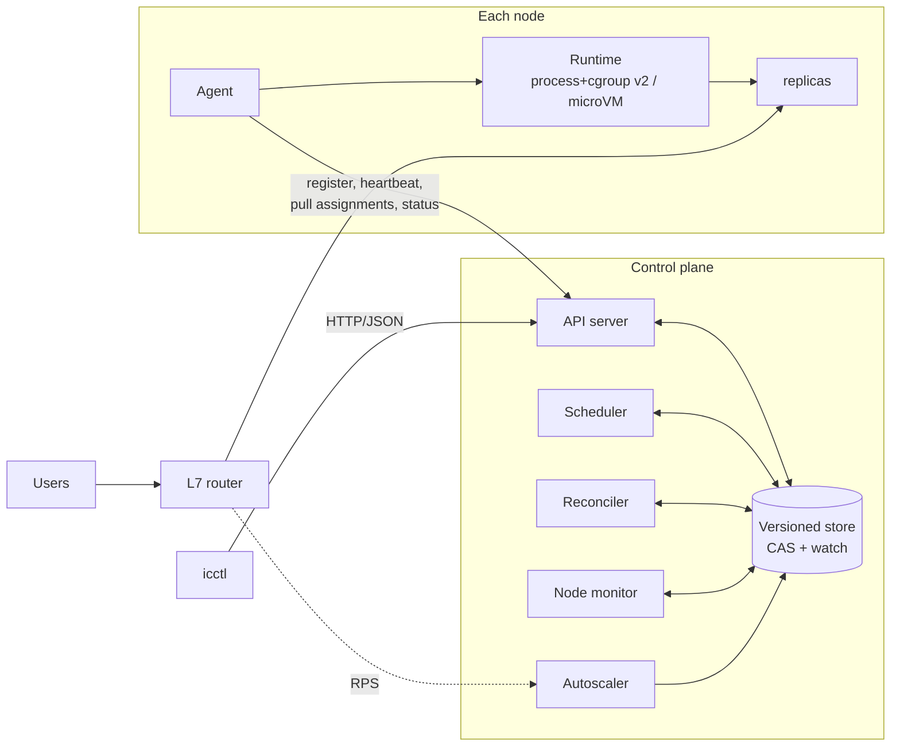

# instacloud-runtime

Compute runtime and orchestration layer for InstaCloud: schedules, runs, routes,
scales and heals stateless and stateful workloads across a fleet of machines.

- **Design doc:** [docs/DESIGN.md](docs/DESIGN.md) - components, lifecycle, decisions and tradeoffs, evolution with scale
- **Problem breakdown:** [docs/REQUIREMENTS.md](docs/REQUIREMENTS.md)
- **Diagrams:** [architecture](docs/diagrams/architecture.md) · [lifecycle & failure recovery](docs/diagrams/lifecycle.md) · [data flow](docs/diagrams/dataflow.md)



## What's implemented

Plain Go, standard library only. Roughly by package:

- `internal/apiserver` - HTTP/JSON API: declarative apply (generation only bumps on real spec
  changes), scale, delete, agent endpoints (register, heartbeat, assignments, status) and an
  NDJSON watch stream.
- `internal/store` - versioned KV with compare-and-swap on every write, watches, snapshots to disk.
- `internal/scheduler` - filter (ready, node selector, volume locality, cpu/mem fit,
  anti-affinity) then weighted score (bin-pack, node/zone spread, balance). Binds with CAS and
  records why something is unschedulable.
- `internal/controller` - the reconciler. Replica counts, rolling updates (surge 1, never drops
  below desired ready capacity), stateful ordering, GC, lost-instance handling.
- `internal/api/lifecycle.go` - instance state machine; the API rejects illegal/stale transitions.
- `internal/agent` - node agent: assignments, ports, volumes, HTTP health checks, exponential
  restart backoff (1s -> 60s), orphan cleanup, self-fencing when it can't reach the control plane.
- `internal/runtime` - `Runtime` interface, a process runtime using cgroup v2 `cpu.max` /
  `memory.max` (with OOM detection and SIGTERM -> SIGKILL), and a fake for tests.
- `internal/nodemon` - heartbeat leases. Missed lease -> node `NotReady` -> its instances `Lost`.
- `internal/router` - `/w/<workload>/` across Running+ready replicas, `/w/<workload>-<n>/` for
  one ordinal, retry + short ejection of bad endpoints, per-workload RPS.
- `internal/autoscaler` - `ceil(rps / target)` within [min, max], with a tolerance band and a
  scale-down window.
- `internal/metrics`, `internal/logging` - Prometheus text `/metrics` and JSON logs.
- `cmd/icctl` - CLI (`apply / get / describe / scale / delete / wait`).

## Running it

Requirements: Go 1.22+, Linux or macOS (cgroup limits are applied on Linux when
the agent can write to `/sys/fs/cgroup`; otherwise it logs a warning and runs
unenforced).

```bash
make test        # unit tests
make race        # unit tests with the race detector
make demo        # build + end-to-end demo (about a minute)
```

The demo (`scripts/demo.sh`) starts a control plane and four node agents locally
and walks through:

1. deploying a 3-replica service and load-balancing across it through the router,
2. crashing a replica -> restart with backoff,
3. failing a replica's health checks -> removed from rotation and restarted,
4. deploying a 3-ordinal stateful workload with volumes and anti-affinity, writing data to `kv-1`,
5. killing the node that runs `kv-1` -> node `NotReady`, stateless replicas replaced at once, `kv-1` moved to
   another node after the fence delay **with its data intact**,
6. a rolling update to a new version,
7. load generation -> the autoscaler scales the service from 2 to 6 replicas,
8. a sample of the Prometheus metrics.

### Running components by hand

```bash
make build
./bin/instacloud-controlplane                       # API :7070, router :8080
./bin/instacloud-agent --name node-1 --zone zone-a --port-base 21000
./bin/instacloud-agent --name node-2 --zone zone-b --port-base 22000

./bin/icctl apply -f examples/web.json
./bin/icctl wait web
./bin/icctl get instances
curl localhost:8080/w/web/

./bin/icctl apply -f examples/kv.json
curl -X PUT --data hi localhost:8080/w/kv-0/kv/greeting
./bin/icctl get volumes

./bin/icctl scale web 5
curl -s localhost:7070/metrics | grep instacloud_
```

Workload specs are JSON; see [`examples/`](examples/) and `internal/api/types.go`.

### Repository layout

```
cmd/
  instacloud-controlplane/   API server + scheduler + reconciler + node monitor + autoscaler + router
  instacloud-agent/          node agent
  icctl/                     CLI
  demoapp/                   sample workload used by the demo
internal/
  api/          object model, validation, lifecycle state machine
  store/        versioned store with CAS + watch + snapshots
  apiserver/    HTTP API
  scheduler/    filter/score plugins and binding loop
  controller/   workload reconciler (services, stateful sets, GC, lost instances)
  nodemon/      heartbeat-based failure detection
  agent/        node agent, health checks, backoff
  runtime/      Runtime interface, process runtime (cgroup v2), fake runtime
  router/       L7 router and request-rate tracking
  autoscaler/   horizontal autoscaler
  metrics/      Prometheus text-format registry
  logging/      structured logging
docs/           design doc, requirements, diagrams
```

## What is left out

Deliberately out of scope for this iteration (reasoning in
[DESIGN.md](docs/DESIGN.md#what-is-left-out-and-why)):

- **Firecracker microVM runtime.** The design picks microVMs for multi-tenant isolation; the
  repo ships the `Runtime` interface and a process runtime that exercises the same agent paths.
- **Overlay networking.** Replicas get host ports rather than their own IPs.
- **Network block storage.** Volumes are directories under a shared root standing in for
  network volumes; binding, fencing and re-attachment logic is real.
- **HA control plane.** Single process with in-memory store + snapshots, instead of etcd/Raft and
  leader-elected controllers.
- **AuthN/Z, multi-tenancy, quotas, image distribution, log shipping, tracing, preemption.**

Known simplifications: agents poll instead of long-polling; the router runs inside the
control-plane process; the autoscaler uses request rate only.

## How this evolves to production

Summarised from [DESIGN.md section 15](docs/DESIGN.md#15-evolution-with-scale):

1. **Production v1 (hundreds of nodes):** etcd-backed store, leader-elected controller replicas,
   watch-based agents with lightweight lease objects for heartbeats, Firecracker runtime, overlay
   network, network block volumes with attachment-level fencing, horizontally scaled router fleet,
   tenant auth and quotas.
2. **Thousands of nodes:** cells of a few thousand nodes with independent control planes behind a
   thin global placement layer; Omega-style optimistic parallel schedulers with node sampling;
   usage-based over-commit, priorities and preemption; fleet autoscaling from pending pressure.
3. **Multi-region:** global API over regional control planes, health-aware global routing, and
   application/storage-level replication for stateful services.

## Tests

`go test ./...` - store, scheduler, reconciler (incl. the rolling-update capacity invariant and
stateful ordering), node monitor, agent against a real API server with a fake runtime, process
runtime, router, autoscaler, metrics. CI runs lint, race tests, build and the full demo.

Open TODO: no chaos-style test yet that kills the control plane mid-rollout and checks it
converges after restart. The demo covers node loss but not that.
