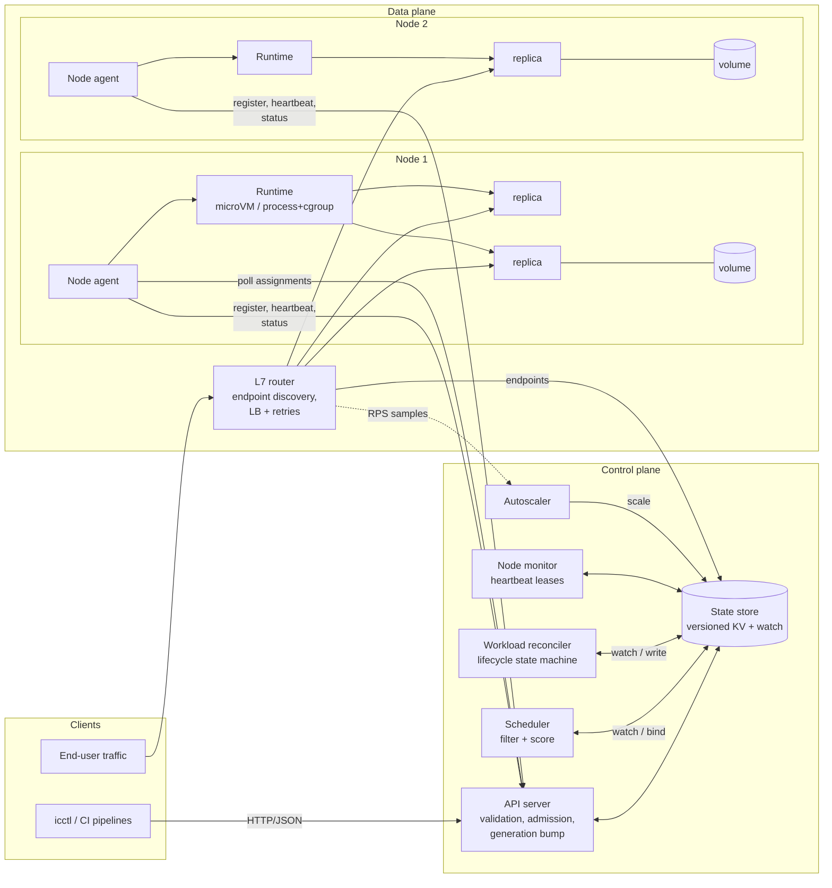

# High-level architecture

**Reading the diagram**

- Everything the control plane knows lives in the **state store**. Components never talk
  to each other directly; they read and write objects and react to watch events.
  This keeps each controller independently restartable and testable.
- **Desired state** (`Workload` specs) is written only by the API server and autoscaler.
  **Actual state** (`Node` heartbeats, `Instance` status) is written by agents.
  The reconciler and scheduler sit in between and close the gap.
- The **node agent** is the only thing that touches a machine. It pulls its assignments
  and pushes status - the control plane never opens connections into nodes, which
  keeps the trust boundary one-directional.
- The **router** is data plane: it caches endpoints and keeps serving with the last known
  set if the control plane is unavailable.
