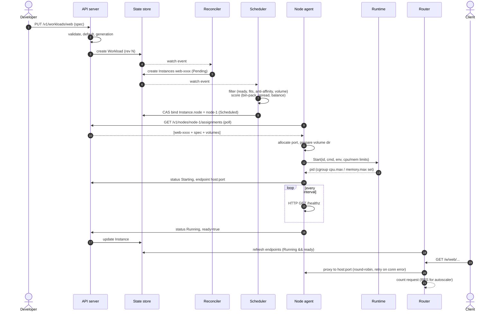

# Data flow: from `apply` to serving traffic

## Write ownership

Each field has exactly one writer, which is what makes the loops safe to run
concurrently without locks (conflicts only happen on genuine races and are
resolved by compare-and-swap + retry):

| Object / field | Writer |
|---|---|
| `Workload.spec` | API server (user), autoscaler (`replicas` only) |
| `Workload.status` | reconciler |
| `Instance` create / delete, `Terminating`, `Lost -> Pending` | reconciler |
| `Instance.node`, `Scheduled` | scheduler |
| `Instance.status` (Starting ... Terminated) | agent on the bound node (via API, transition-checked) |
| `Instance` -> `Lost`, `Node.status = NotReady` | node monitor |
| `Node.lastHeartbeat`, `Node` registration | agent (via API) |
| `Volume.boundNode` | scheduler (bind), reconciler (release after fencing) |
