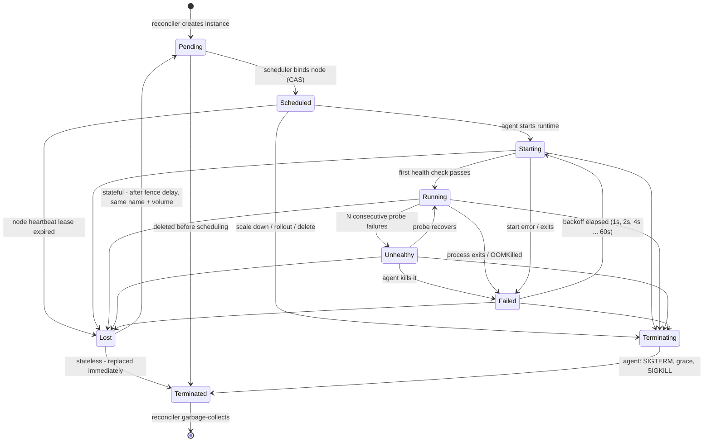
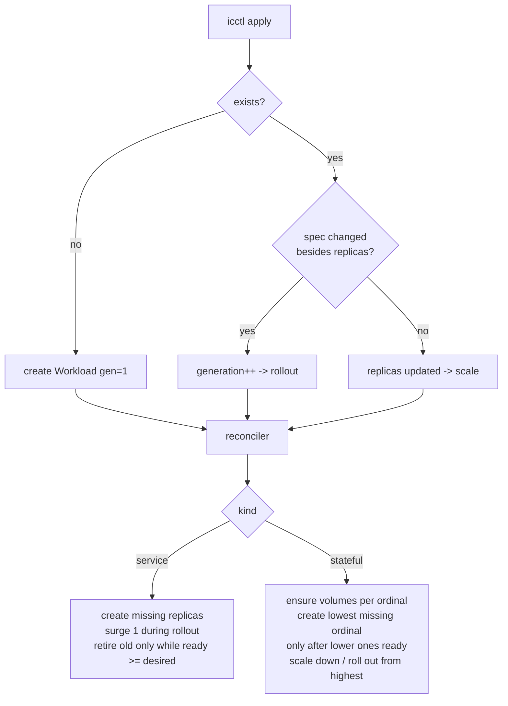
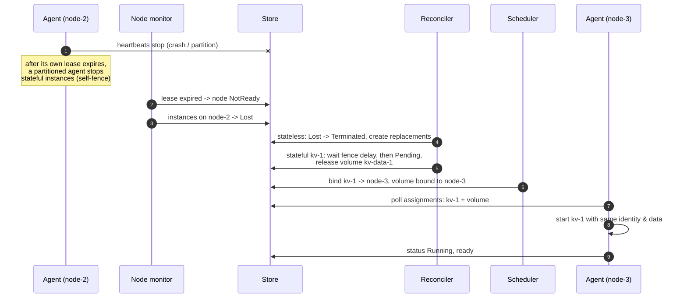

# Instance lifecycle

The state machine enforced by `api.CanTransition` and driven by the
reconciler, scheduler, node monitor and agent. Labels say who makes each move.

## Workload-level lifecycle

## Node failure and recovery

